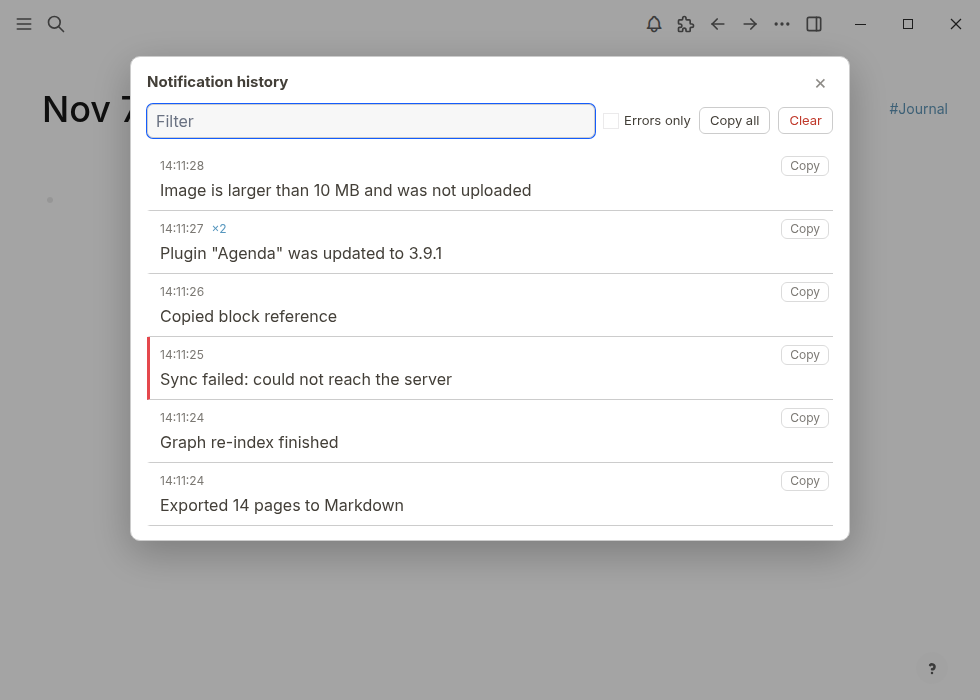

# Notification History for Logseq

Logseq's pop-up messages disappear after a few seconds. A sync fails, an export finishes, a plugin reports
something, and if you were looking away it's gone. There's a command to clear them, but no list of the ones you missed.

This plugin keeps them.

Every message that Logseq or a plugin shows is saved with its time. Open the list with the bell in the toolbar or
the command **Show notification history** in the command palette.

- Newest first. The same message shown again within 10 seconds is counted (`×2`) instead of repeated.
- Error messages get a red mark, and **Errors only** shows just those.
- Messages that change while on screen are saved with their last text. Buttons inside a message are left out.
- Filter box, a copy button on each message, **Copy all** and **Clear**.
- The bell shows how many messages came in since you last looked.

## Settings

- Keep history after restart: on by default. Off keeps the list in memory only.
- Notifications to keep: 50 to 1000, default 200.

The history is saved in the plugin's own storage (`~/.logseq/storages/notification-history/`). Nothing leaves your
device.

## Limits

It reads the messages from Logseq's window, so it needs the plugin setting that lets it run in the main window
(`effect`). It records from the moment it loads, so the very first messages at startup are missed. Tested on
Logseq 2.0.2 (Linux) with a database graph. It doesn't read or change your graph.

## Same plugin for other apps

[Obsidian](https://community.obsidian.md/plugins/notice-history), [SiYuan](https://github.com/prometheus-maker/siyuan-notification-history).

## Licence

MIT. Problems and ideas: open an issue.
